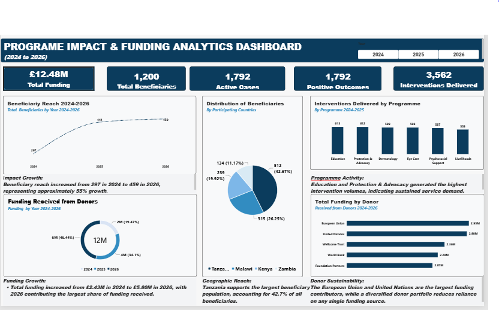
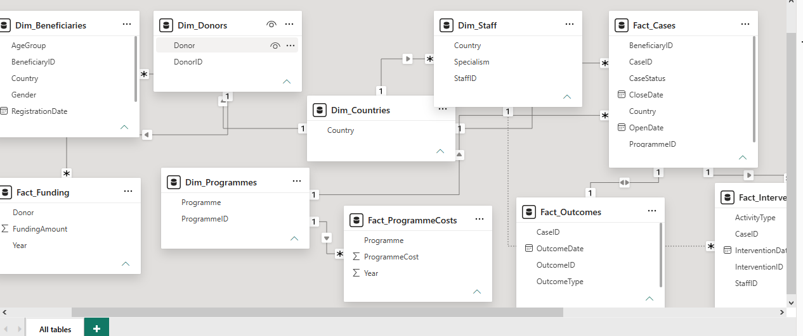

# Data Analytics Portfolio

# Charities Project

**Title:** [Non-Profit Programme Impact & Funding Analytics Dashboard](https://github.com/LuckyObinnaNjoku/LuckyObinnaNjoku.github.io/blob/main/portfolio_powerbi_NGO.pbix)

**Tools Used:** Power BI • Power Query • DAX • Data Modelling • Excel/CSV • GitHub

**Project Description:** Developed an executive-level Power BI dashboard to analyse beneficiary reach, programme performance, intervention activity, donor contributions, and funding trends across a multi-country non-profit organisation.
The solution was designed to support impact reporting, programme evaluation, donor reporting, and strategic decision-making between 2024 and 2026.

**Key findings:**

**Impact Growth:**
*Beneficiary reach increased by approximately 55% between 2024 and 2026, demonstrating sustained organisational growth and an expanding ability to deliver support to vulnerable communities across multiple regions.*

**Geographic Reach:**
*Tanzania emerged as the organisation's primary area of service delivery, accounting for 42.7% of beneficiaries. This suggests a strong operational presence in the region but also highlights opportunities to expand reach in lower-volume countries such as Zambia.*

**Programme Demand**
*Education and Protection & Advocacy recorded the highest intervention volumes, indicating that beneficiaries continue to require significant support in access to education, rights protection, and inclusion services. These programmes may require continued investment to sustain demand.*

**Funding Growth**
*Funding more than doubled during the reporting period, increasing from £2.43M to £5.80M. The growth in funding provides greater capacity for programme expansion, service delivery, and long-term organisational sustainability.*

**Donor Sustainability**
*While the European Union and United Nations were the largest contributors, funding remained distributed across several major donors. This reduces dependency on a single funding source and strengthens financial resilience against future funding uncertainty.*

**Strategic Implication**
*The combination of growing beneficiary reach, increasing funding, and sustained programme demand suggests that the organisation is well-positioned to scale its impact. Future efforts should focus on maintaining donor diversification while expanding service coverage in underrepresented regions.*

**Dashboard Overview:**

**Data Modelling Overview:**

